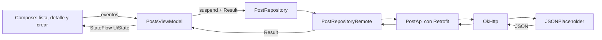
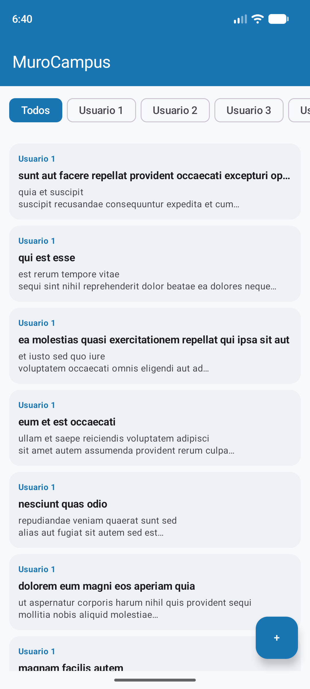
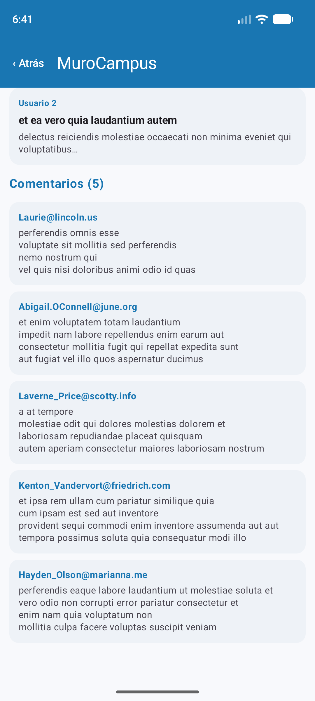
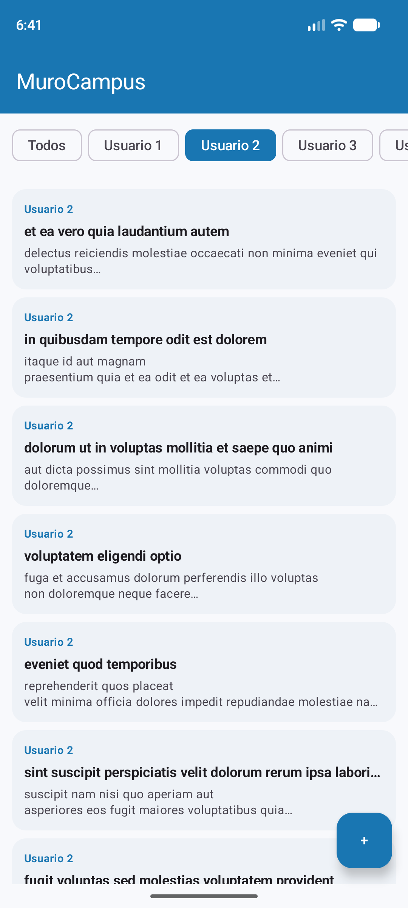
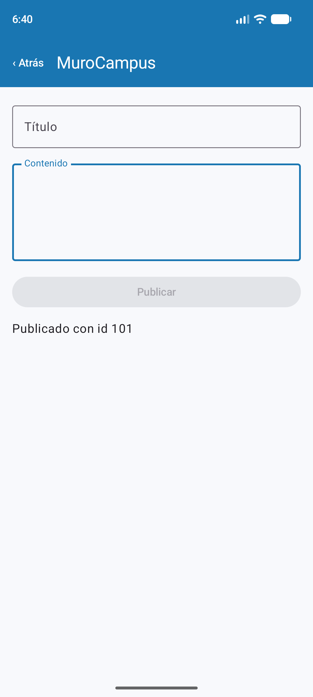
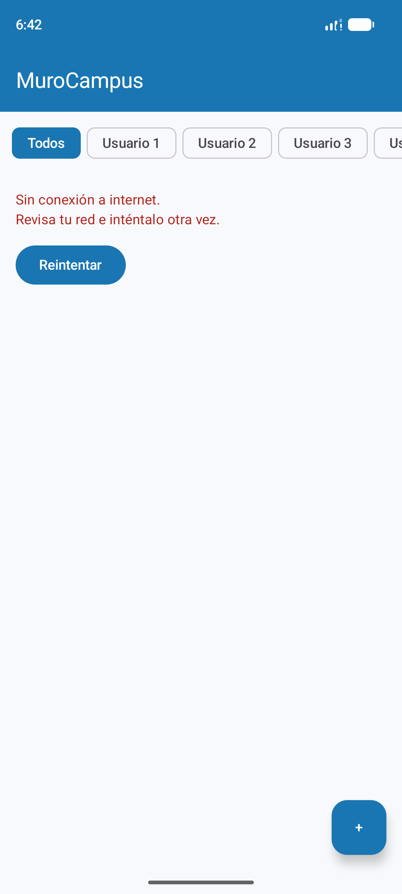

# MuroCampus · Laboratorio 09 actualizado

Aplicación Android para consultar un muro de publicaciones REST. El laboratorio actualizado trabaja con Kotlin, Jetpack Compose, Retrofit, OkHttp, Kotlin Serialization, MVVM y Repository.

## Qué permite hacer

- Cargar publicaciones del servicio JSONPlaceholder y mostrar título, resumen y usuario.
- Abrir una publicación y leer sus comentarios.
- Filtrar el muro por usuario, desde Todos hasta Usuario 10.
- Enviar una publicación con título y contenido; ambos campos se validan antes del envío.
- Buscar publicaciones localmente por palabras del título sin volver a consultar el servicio.
- Solicitar la eliminación de una publicación; la interfaz aclara que el resultado es demostrativo.
- Presentar carga, éxito y error con una opción para reintentar.

JSONPlaceholder simula el envío: responde con el identificador 101, pero no conserva la publicación después de volver a consultar la lista.
La operación `DELETE` también es demostrativa: el servicio acepta la solicitud, pero no borra de forma persistente el registro.

## Estructura

```text
app/src/main/java/com/tecsup/murocampus/
├── MainActivity.kt
├── model/Modelos.kt
├── data/
│   ├── PostRepository.kt
│   └── remote/
│       ├── PostApi.kt
│       └── RetrofitClient.kt
├── viewmodel/
│   ├── PostsViewModel.kt
│   ├── PostsViewModelFactory.kt
│   └── UiState.kt
└── ui/
    ├── Componentes.kt
    ├── PantallaLista.kt
    ├── PantallaDetalle.kt
    └── PantallaCrear.kt
```

La pantalla observa el estado del ViewModel. El ViewModel coordina las operaciones y publica `UiState`; el Repository encapsula los errores de red y entrega `Result`; `PostApi` declara las rutas Retrofit.



## Endpoints

| Acción | Ruta |
|---|---|
| Listar | `GET /posts` |
| Ver publicación | `GET /posts/{id}` |
| Leer comentarios | `GET /posts/{id}/comments` |
| Filtrar | `GET /posts?userId={id}` |
| Crear | `POST /posts` con los datos en el cuerpo JSON |
| Eliminar (ampliación) | `DELETE /posts/{id}`; respuesta simulada, sin persistencia |

## Abrir en Android Studio

Abre esta carpeta, sincroniza Gradle y ejecuta la configuración `app`. Se necesita Internet para cargar o enviar información.

## Evidencias y sustentación

Las capturas solicitadas y los casos de comprobación también están en [EVIDENCIAS.md](EVIDENCIAS.md). Las respuestas completas para estudiar la guía están en [REFLEXION.md](REFLEXION.md).

### Capturas del emulador











### Respuestas breves para la sustentación

1. `GET` consulta; `POST` envía datos. El formulario usa `@Body` para mandar el objeto y el filtro usa `@Query` para añadir `userId` a la URL.
2. `posts` es una ruta relativa que Retrofit combina con la URL base, que ya termina en `/`.
3. `Result` mantiene los errores dentro del Repository y permite que el ViewModel los transforme en un estado visible. La cancelación se relanza.
4. Sin `INTERNET` no hay solicitudes de red. `ignoreUnknownKeys` descarta campos adicionales; si falta un campo obligatorio del modelo, la deserialización puede fallar.
5. `UiState` limita la pantalla a un estado claro: cargando, éxito o error. `when` presenta la vista que corresponde.
6. JSONPlaceholder no persiste el `POST`. En un backend real, la publicación guardada volvería en futuras consultas, con las validaciones y permisos de ese servicio.

## Uso de asistencia

Esta implementación se realizó con asistencia de Codex por solicitud del estudiante. Aunque la guía denomina a `main` fase SinIA, no se debe afirmar que esta versión se desarrolló sin apoyo de IA. El estudiante debe revisar y comprender el código antes de sustentarlo.

## Ampliaciones de mejora-ia

La rama `mejora-ia` añade búsqueda local por título, eliminación demostrativa y el encabezado `Accept: application/json` en las solicitudes. El alcance original del laboratorio se conserva.
