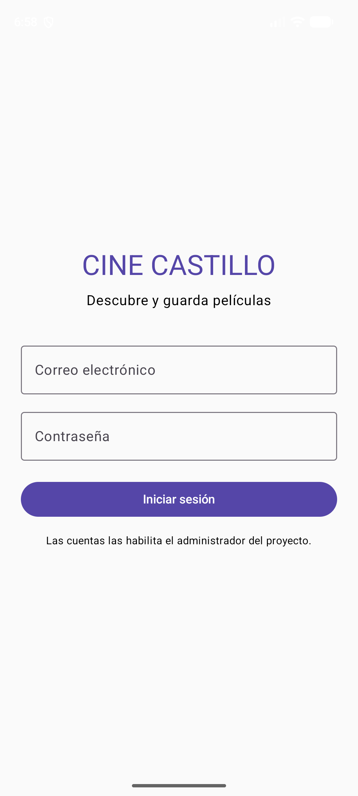
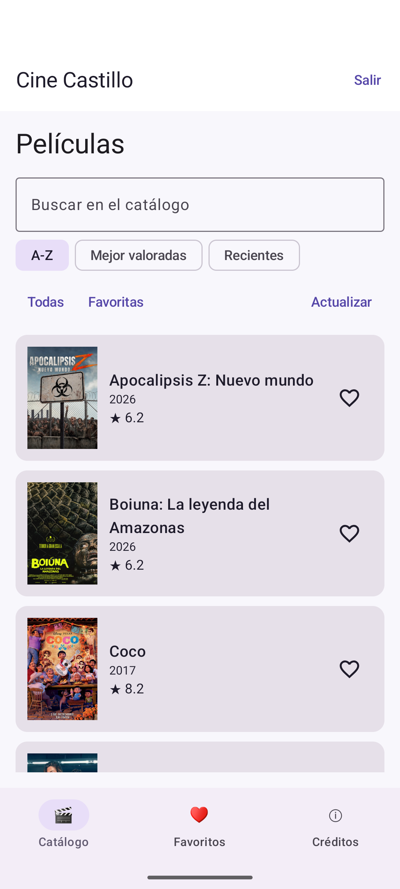
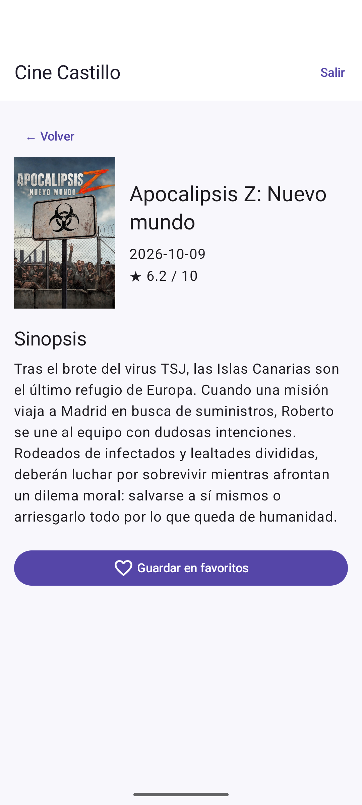
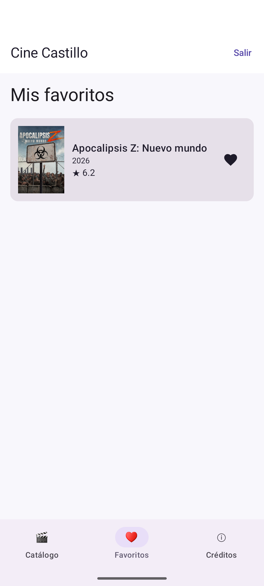
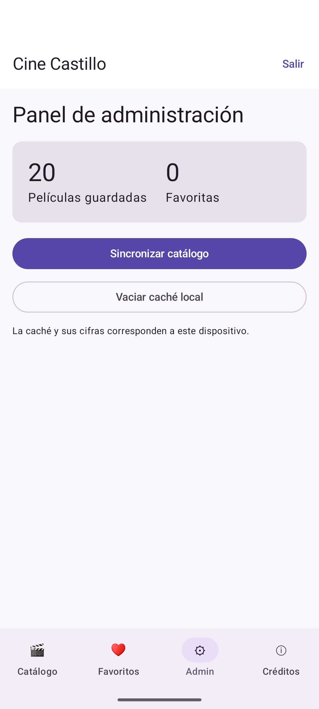
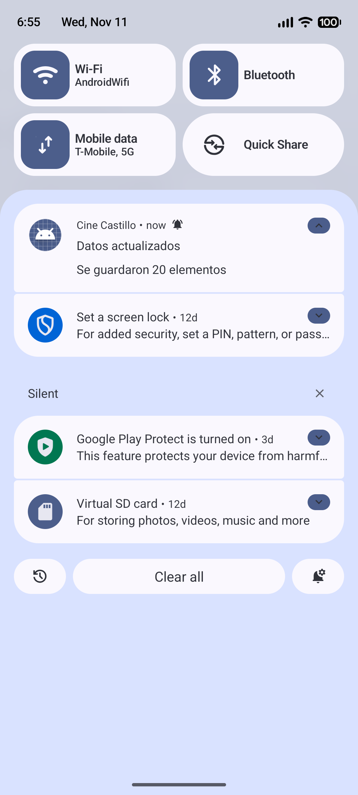

# Cine Castillo

Aplicación de películas del **Laboratorio 12 de Programación en Móviles**. Desarrollada por **Jesús Castillo Sumire**, sección **C24D**, con Kotlin y Jetpack Compose.

## Entrega

- **Versión mejorada:** `mejora-ia` · **Versión base:** `main`.
- **Verificación:** 14 pruebas de aceptación en Pixel 8 y 8 pruebas unitarias aprobadas el 11/11/2026.
- [Registro de pruebas y evidencias](PRUEBAS_ACEPTACION.md) · [Indicaciones y reflexión](PROMPTS.md).
- [APK y versiones publicadas](https://github.com/JesusCastillo2026/Programacion-En-Moviles/releases).
- Proyecto individual alojado en el repositorio del curso. TMDB reemplaza las API básicas sugeridas en la guía según la indicación del docente.

## Funciones

- Firebase Authentication y roles `usuario` / `admin` consultados en Firestore.
- Catálogo y detalle desde dos endpoints TMDB. Carteles, título, fecha, valoración y sinopsis.
- Búsqueda local y orden por título, valoración o fecha sobre la copia disponible.
- Room como fuente de la interfaz; favoritas persistentes que se conservan al sincronizar.
- Estados Cargando, Error con Reintentar y Vacío. Catálogo disponible sin conexión después de descargarlo.
- Arranque sin datos ni red con error recuperable; al recuperar Internet se permite iniciar sesión.
- Panel exclusivo del administrador: totales, sincronización y vaciado confirmado de la caché.
- Canal y permiso de notificaciones; aviso con cantidad guardada que abre la app al tocarlo.
- Estado conservado al girar y encabezado desplazable para mantener visibles las tarjetas en horizontal.
- Créditos y atribución de TMDB dentro de la aplicación.

## Estructura

```text
app/src/main/java/com/tecsup/cinecastillo/
├── MainActivity.kt, CineApplication.kt, AppContainer.kt
├── data/
│   ├── auth/          interfaz AuthRepository e implementación Firebase
│   ├── remote/        MovieApi, RetrofitClient y dto/
│   ├── local/         Entity, Dao y Database de Room
│   ├── repository/    interfaz MovieRepository e implementación Room
│   └── mapper/        conversiones DTO → Entity → Movie
├── domain/model/      Movie y Sesion
├── notification/      interfaz Notificador e implementación Android
└── ui/
    ├── UiState.kt
    ├── navigation/    AppNav
    ├── login/         pantalla y ViewModel
    ├── lista/         pantalla y ViewModel
    ├── detalle/       pantalla y ViewModel
    ├── favoritos/     pantalla y ViewModel
    ├── admin/         pantalla y ViewModel
    ├── components/    Cargando y ErrorView
    └── theme/         tema Compose
```

`Movie` y `MovieApi` adaptan los nombres genéricos Item y ApiService al tema. Se conservan los métodos de contrato `iniciarSesion`, `sesionActual`, `cerrarSesion`, `refrescar`, `obtenerDetalle`, `alternarFavorito`, `cantidadGuardada`, `cantidadFavoritos` y `limpiarCache`.

## Flujo

```text
Firebase Auth → usuarios/{uid} en Firestore → sesión con rol
Login → Catálogo → Detalle → Favoritos
                ↘ Admin (solo administrador)
TMDB → Retrofit → Repositorio → Room → ViewModel → Compose
```

Los ViewModel reciben interfaces mediante factories y publican `StateFlow<UiState<T>>`. Compose observa con `collectAsStateWithLifecycle`. `CineApplication` mantiene un contenedor por proceso; los ViewModel no contienen Context. Los eventos de pantalla pasan al ViewModel, que delega operaciones al repositorio.

## Abrir y configurar

1. Abre **esta carpeta** en Android Studio y utiliza JDK 17 o el JDK compatible configurado por Android Studio.
2. Registra en Firebase el paquete `com.tecsup.cinecastillo` y copia `google-services.json` dentro de `app/`.
3. Habilita Correo/contraseña en Authentication. Crea las cuentas de prueba desde la consola.
4. Crea `usuarios/{uid}` en Firestore con `rol` de texto: `admin` o `usuario`. Publica [firestore.rules](firestore.rules); la aplicación no modifica su rol.
5. Añade `TMDB_API_KEY=tu_clave` a `local.properties`, además de la ruta local de Android SDK.
6. Sincroniza Gradle y ejecuta `app` con Internet para el primer acceso y la descarga.

Firebase del laboratorio: `cine-castillo-semana-12`. El JSON debe pertenecer a este proyecto, no a Semana 11. Las credenciales personales y `local.properties` no se versionan.

## Verificación

```text
./gradlew :app:assembleDebug :app:testDebugUnitTest
```

En Windows se utiliza `gradlew.bat`. Las pruebas automatizadas cubren carga, fallos de red, caché, filtros, orden, notificaciones y recuperación de sesión. La matriz de las 14 pruebas reales, sus condiciones y capturas está en [PRUEBAS_ACEPTACION.md](PRUEBAS_ACEPTACION.md).

## Capturas

| Acceso | Catálogo | Detalle |
|---|---|---|
|  |  |  |

| Favoritos | Administración | Notificación |
|---|---|---|
|  |  |  |

## Decisiones de almacenamiento

La caché y las favoritas pertenecen al dispositivo. Firebase conserva la identidad y Firestore el rol; no se sincronizan favoritas entre teléfonos. Las imágenes remotas dependen de su caché de carga. La clave de lectura se mantiene fuera de Git, aunque puede extraerse del APK de demostración publicado con autorización.

This product uses the TMDB API but is not endorsed or certified by TMDB.
