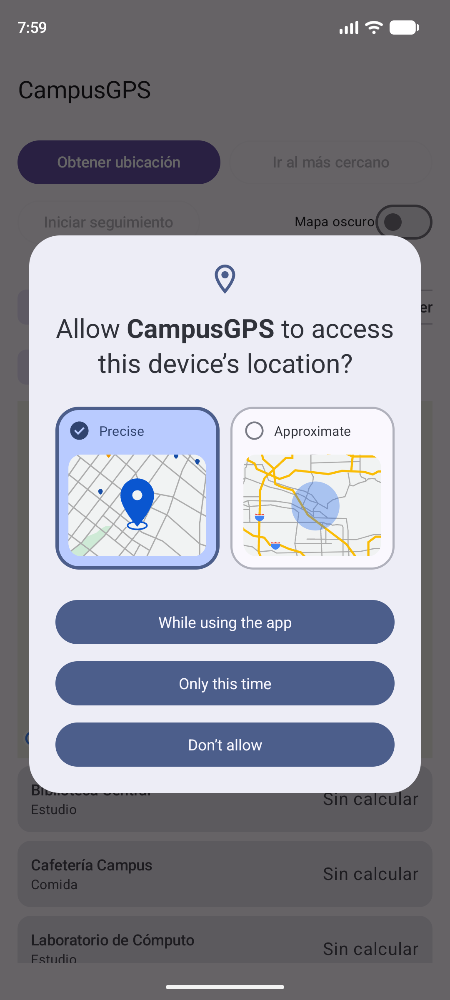
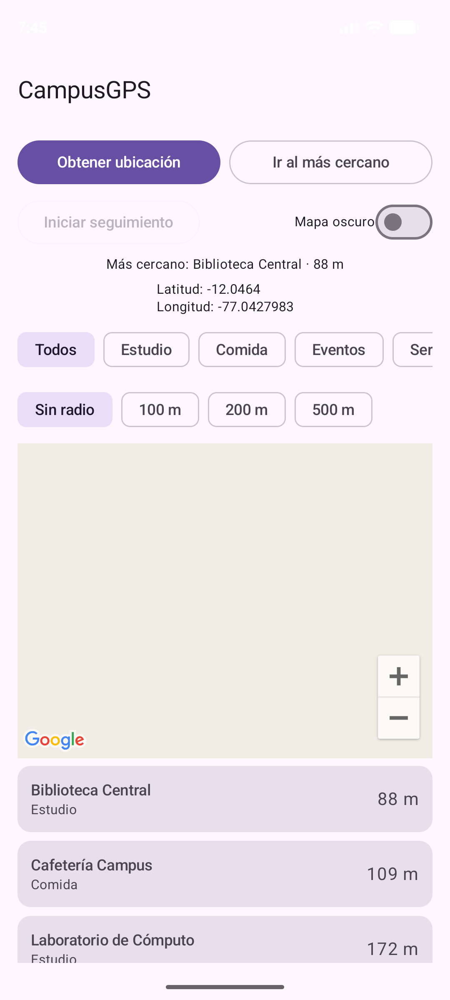
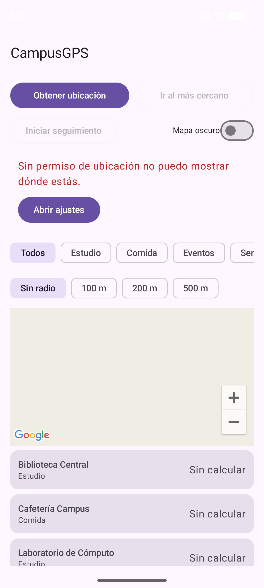
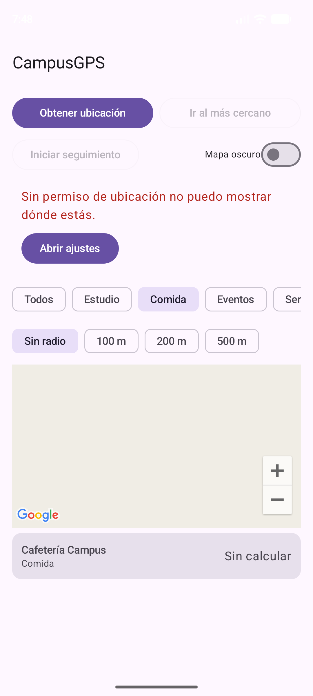
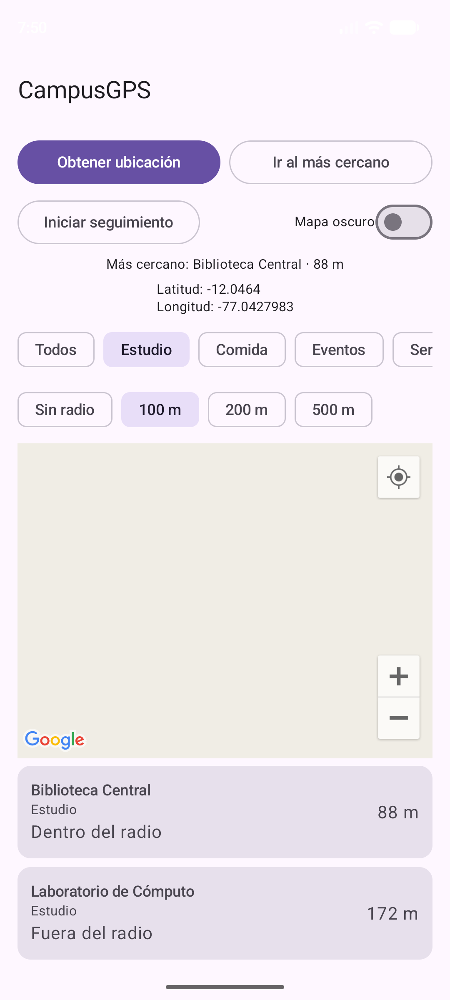

# CampusGPS

CampusGPS es una aplicación Android que muestra cinco puntos de interés de prueba alrededor de TECSUP Lima y permite comparar su distancia con la ubicación del dispositivo. La desarrollé para el Laboratorio 13 de Programación en Móviles, usando Kotlin, Jetpack Compose y una organización MVVM con Repository.

La rama `main` contiene la versión base del laboratorio. En `mejora-ia` agregué filtros por categoría, radios de cercanía, seguimiento de ubicación, recuerdo del último punto y un estilo oscuro del mapa. Por indicación del docente, la rama mejorada muestra el mapa con MapLibre y estilos públicos de OpenFreeMap; la ubicación sigue obteniéndose con Google Play Services.

## Abrir y ejecutar

Abre esta carpeta en Android Studio, sincroniza Gradle y ejecuta la configuración `app`. Para la rama `mejora-ia`, el mapa no necesita una clave de Google Maps, pero sí Internet para descargar el estilo y los mosaicos. Para obtener la posición se necesita permiso de ubicación y un dispositivo con Google Play Services.

La cámara inicia en TECSUP Sede Lima, Av. Cascanueces 2221, Santa Anita, aproximadamente en `-12.04398, -76.95291`. En el emulador puedes establecer esa ubicación desde Extended Controls → Location. La ubicación del usuario es real solo cuando el proveedor del dispositivo entrega una posición; el pin del campus es una referencia fija.

## Qué lugares aparecen

Los cinco lugares son datos de demostración, con coordenadas relativas al punto central de TECSUP. Sus nombres describen áreas de prueba, pero la posición exacta de cada edificio aún debe confirmarse con el plano o la imagen satelital anotada por el estudiante.

| ID | Punto | Categoría | Estado de ubicación |
|---:|---|---|---|
| 1 | Biblioteca Central | Estudio | Demostración; por confirmar en el plano del campus |
| 2 | Cafetería Campus | Comida | Demostración; por confirmar en el plano del campus |
| 3 | Laboratorio de Cómputo | Estudio | Demostración; por confirmar en el plano del campus |
| 4 | Auditorio Principal | Eventos | Demostración; por confirmar en el plano del campus |
| 5 | Estacionamiento Norte | Servicios | Demostración; por confirmar en el plano del campus |

## Estructura de carpetas

```text
CampusGPS/
├── app/src/main/java/com/tecsup/campusgps/
│   ├── data/          Repositorios de ubicación, lugares y preferencias
│   ├── model/         Posición, lugar y estados de pantalla
│   ├── ui/            Pantalla, mapa y componentes visuales
│   ├── util/          Distancia, formato y reglas de filtro/proximidad
│   ├── viewmodel/     Estado y coordinación de acciones
│   └── MainActivity.kt Punto de entrada e inicialización del mapa
├── app/src/test/      Pruebas unitarias de las reglas de filtro y radio
└── docs/
    ├── evidencias/    Capturas registradas durante el desarrollo
    ├── Informe_Laboratorio_13_CampusGPS.pdf
    ├── PRUEBAS_ACEPTACION.md
    └── crear_informe.py
```

## Cómo se conectan las capas

```text
PantallaMapa (Compose)
        ↓ eventos y StateFlow
MapaViewModel
        ↓ interfaces
UbicacionRepositoryGoogle ── FusedLocationProviderClient
LugaresRepositoryLocal ───── cinco puntos de demostración
PreferenciasLugarRepositoryDataStore ─ último punto seleccionado
        ↓
MapaLibre Native ─────────── estilos públicos de OpenFreeMap
```

La pantalla se ocupa de mostrar controles y estado. El ViewModel coordina la búsqueda, las distancias, los filtros y el seguimiento. Los repositorios esconden los detalles de Google Play Services, los datos locales y DataStore. El mapa es otra pieza: recibe el estado y dibuja los marcadores, la línea directa y el radio, sin consultar el GPS por su cuenta.

## Capturas del laboratorio

Las capturas existentes documentan la versión anterior a la migración del proveedor del mapa. Se incluyen para mostrar los flujos que sí se observaron, pero no demuestran que OpenFreeMap cargue en el emulador. En `PRUEBAS_ACEPTACION.md` queda anotado este límite para no confundir evidencia histórica con una verificación actual.

### Permiso de ubicación



### Pantalla con ubicación y distancias, captura anterior



### Manejo del permiso denegado



### Filtro por categoría



### Selección del radio de proximidad



## Pruebas y entrega

La compilación limpia `clean testDebugUnitTest assembleDebug` terminó correctamente y las cinco pruebas unitarias pasaron. En esta sesión el emulador Pixel 8 no inició porque el entorno indicó que la virtualización/aceleración requerida no está disponible. Por eso los doce casos manuales no se presentan como aprobados: sus resultados y evidencias previas están en [PRUEBAS_ACEPTACION.md](PRUEBAS_ACEPTACION.md).

La versión base cuenta con diez commits de laboratorio en `main`. La versión ampliada está en `mejora-ia`, con su registro de decisiones en [PROMPTS.md](PROMPTS.md). La guía completa, con explicación de archivos y bloques importantes, se encuentra en el [informe PDF](docs/Informe_Laboratorio_13_CampusGPS.pdf).

## Reflexión

1. **¿Por qué FusedLocationProviderClient está dentro del Repository?** Porque depende de servicios de Android y permisos de plataforma. Al dejarlo detrás de una interfaz, el ViewModel puede pedir una posición sin conocer el `Context` ni la clase concreta del proveedor.
2. **¿Qué diferencia hay entre el permiso de ubicación y el proveedor del mapa?** El permiso autoriza a la app a leer la ubicación del dispositivo. MapLibre y OpenFreeMap dibujan el mapa y descargan sus mosaicos por Internet. En esta rama no se usa una clave de Google Maps.
3. **¿Por qué no se sube una clave en el código y qué haría si se filtrara?** Una clave publicada puede usarse fuera de la app y consumir el servicio asociado. La revocaría en el proveedor, generaría otra y revisaría el historial y las restricciones. En `mejora-ia` el mapa actual no utiliza esa clave.
4. **¿Dónde calculo la distancia y por qué no en un Composable?** La distancia se calcula en la lógica coordinada por el ViewModel mediante una función utilitaria. Así Compose se limita a presentar el valor, y la regla se puede probar sin dibujar la pantalla.
5. **¿Qué ocurre si se niega el permiso dos veces?** Android puede dejar de mostrar el diálogo. La app presenta el estado de permiso denegado y ofrece abrir los ajustes de la aplicación para que la persona decida si quiere habilitarlo.
