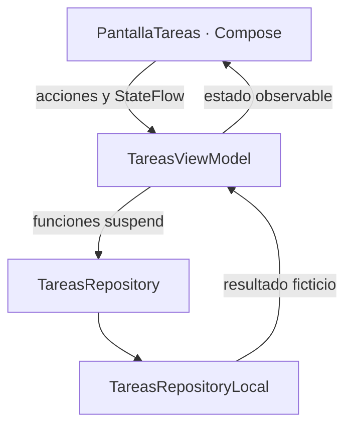

# CentroTareas - Laboratorio 14

Aplicación Android hecha con Kotlin, Jetpack Compose y Material 3 para practicar corrutinas, cancelación, progreso y trabajo concurrente. Esta carpeta contiene la versión base solicitada para `main`; la presentación y las funciones extra de `mejora-ia` se documentan por separado.

## Qué hace

- Ejecuta una tarea de cuatro segundos fuera del hilo principal, informa el porcentaje y permite cancelarla.
- Mantiene un contador de toques visible mientras corre la tarea.
- Cuenta números primos desde el Repository en `Dispatchers.Default`, con comprobación de cancelación. El valor inicial se ajustó para tardar aproximadamente 2.7 segundos en el emulador usado.
- Compara la carga secuencial del perfil ficticio y los pedidos con la carga concurrente usando `async` y `await`.
- Permite simular una falla de red, muestra el error sin cerrar la aplicación y habilita Reintentar.

Los datos de perfil y pedidos son demostrativos. No se requiere una conexión real a internet.

## Estructura

```text
app/src/main/java/com/tecsup/centrotareas/
├── MainActivity.kt
├── model/Estados.kt
├── data/
│   ├── TareasRepository.kt
│   └── TareasRepositoryLocal.kt
├── viewmodel/
│   ├── TareasViewModel.kt
│   └── TareasViewModelFactory.kt
└── ui/PantallaTareas.kt
```

## Cómo se conectan las capas



La pantalla presenta estados y envía acciones. El ViewModel conserva el estado con `StateFlow`, inicia las corrutinas con `viewModelScope` y cancela sus `Job`. El Repository ejecuta el cálculo de primos y entrega las cargas simuladas. Cuando se actualiza el estado, Compose vuelve a dibujar la parte necesaria.

## Observación del ejercicio de bloqueo

En el primer paso guiado, `Thread.sleep(4000)` se usa de forma temporal para provocar el problema. Mientras ese código ocupa `main`, Android no puede dibujar el mensaje “Trabajando...” ni atender el contador. Al finalizar la espera, la interfaz vuelve a responder; con diez segundos, se percibiría congelada por más tiempo y Android podría advertir que la aplicación no responde. Ese fragmento queda en el historial didáctico del commit del paso, pero no forma parte del código final. La solución final usa `viewModelScope`, `withContext(Dispatchers.Default)` y `delay`.

## Decisiones de implementación

- `Dispatchers.Default` se usa para el cálculo intensivo de primos.
- `delay` simula operaciones suspendibles sin bloquear el hilo.
- `coroutineScope` y `async` ejecutan perfil y pedidos concurrentemente; `await` espera ambos resultados.
- Las cargas tardan cerca de 5 segundos secuencialmente y 3 segundos en paralelo en el emulador.
- Los estados de carga distinguen inicio, progreso, éxito y error.
- La interfaz azul, el orden de las tres tarjetas y los estados de los botones siguen el esquema de la guía.

## Pruebas de aceptación

Las 12 pruebas de la guía se ejecutaron en el emulador Pixel 8 API 37.2. El detalle y las capturas están en [`PRUEBAS_ACEPTACION.md`](PRUEBAS_ACEPTACION.md) y [`docs/capturas`](docs/capturas/).

| Prueba | Resultado observado |
|---|---|
| El contador responde durante la tarea | Aprobada |
| Logcat distingue `main` y `DefaultDispatcher-worker` | Aprobada |
| La barra llega a 100 % en unos 4 s | Aprobada |
| Cancelación detiene progreso y permite iniciar otra vez | Aprobada |
| El botón de inicio queda deshabilitado mientras corre | Aprobada |
| Hasta 1,000 se cuentan 168 primos | Aprobada |
| El cálculo grande permite cancelar sin congelar UI | Aprobada |
| Carga secuencial cercana a 5 s | Aprobada (5,037 ms) |
| Carga paralela cercana a 3 s | Aprobada (3,006 ms) |
| Error y reintento permiten recuperar la carga | Aprobada |
| La tarea sobrevive a la rotación | Aprobada |
| El código final no contiene APIs prohibidas | Aprobada |

## Capturas

- Progreso y contador respondiendo: [`02-main-progreso-interactivo.png`](docs/capturas/02-main-progreso-interactivo.png)
- Cancelación de la tarea: [`03-main-cancelacion.png`](docs/capturas/03-main-cancelacion.png)
- Resultado de primos (1,000 = 168): [`04-main-primos-1000.png`](docs/capturas/04-main-primos-1000.png)
- Carga secuencial: [`05-main-carga-secuencial.png`](docs/capturas/05-main-carga-secuencial.png)
- Carga paralela: [`06-main-carga-paralela.png`](docs/capturas/06-main-carga-paralela.png)
- Falla y reintento: [`07-main-error-y-reintento.png`](docs/capturas/07-main-error-y-reintento.png), [`09-main-reintento-recuperado.png`](docs/capturas/09-main-reintento-recuperado.png)
- Registro de hilos: [`logcat-hilo-main.txt`](docs/capturas/logcat-hilo-main.txt)

## Para pensar

1. **¿Por qué no se veía “Trabajando...” en el Paso 1?** Porque el hilo principal no podía procesar el siguiente dibujo hasta que terminara `Thread.sleep`.
2. **¿Qué diferencia hay entre `Thread.sleep` y `delay`?** `Thread.sleep` detiene el hilo que lo ejecuta. `delay` suspende la corrutina y libera el hilo para otras tareas.
3. **¿Por qué `Default` para primos y `IO` para red?** Primos consume CPU y corresponde a `Default`; una petición de red real espera entrada/salida y normalmente corresponde a `IO`. En esta práctica las cargas son simuladas con `delay`.
4. **¿Qué pasa al cerrar la pantalla y qué hace `viewModelScope`?** Al destruirse el ViewModel, su scope cancela las corrutinas ligadas a él. Durante una rotación normal el mismo ViewModel se conserva, por eso la tarea continúa.
5. **¿Por qué `async` tarda unos 3 s y no 5 s? ¿Qué pasa si una carga falla?** Las dos operaciones comienzan juntas y el tiempo se aproxima a la más larga. Si una falla, el scope concurrente propaga el error y el estado pasa a Error, desde donde se puede reintentar.

## Verificación de código final

El código fuente Kotlin no contiene `GlobalScope`, `runBlocking` ni `Thread.sleep`. El ejemplo bloqueante se muestra solamente en el commit histórico dedicado a observar el problema.
